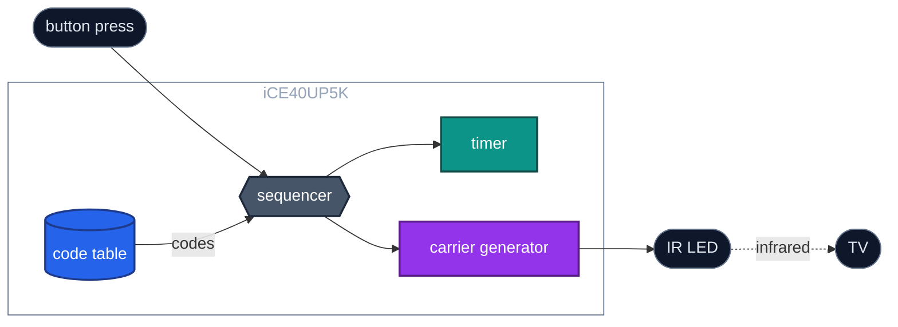
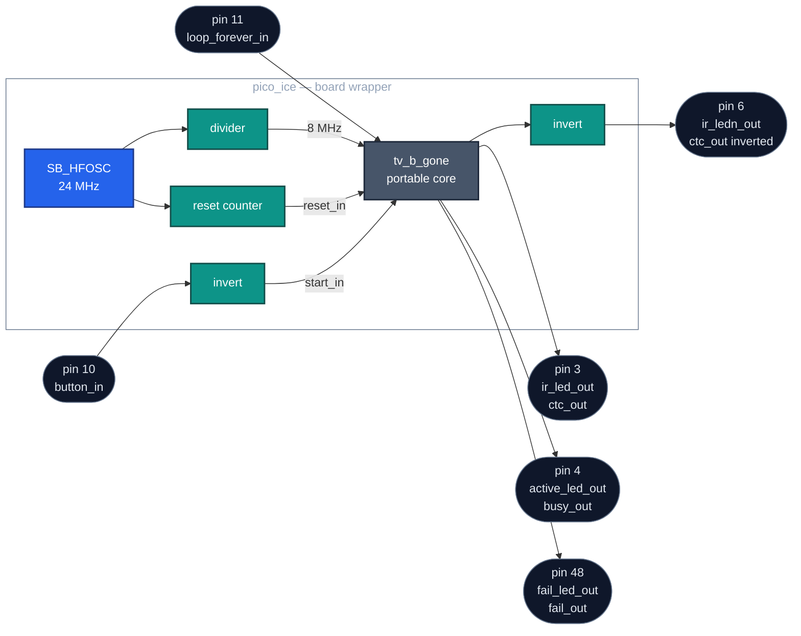

# TV-B-Gone on iCE40

The TV-B-Gone universal TV power-off remote, reimplemented in SystemVerilog for
the Lattice iCE40UP5K FPGA on a [Pico-ICE](https://github.com/tinyvision-ai-inc/pico-ice)
board. No processor, no firmware: a state machine, two counters and a code table
in logic.

- [What it does](#what-it-does)
- [Responsible use](#responsible-use)
- [Features](#features)
- [How it works](#how-it-works)
- [Quick start](#quick-start)
- [Repository layout](#repository-layout)
- [Documentation](#documentation)
- [Status and limitations](#status-and-limitations)
- [Credits and license](#credits-and-license)

## What it does

Press the button and the gadget transmits the power-off command of about 140
television models, one after another, through an infrared LED. A TV that
recognises one of them switches off.

There is no universal "off" code. Every manufacturer chose its own carrier
frequency, timings and command format, so the only way to switch off an unknown
TV is to try them all. One pass through the European table takes about 24
seconds.

The original TV-B-Gone is a small AVR microcontroller running C firmware. This
project plays the same code tables with dedicated hardware instead, and is
written as a complete, small FPGA design to learn from: RTL, ROM data, pin
constraints, build flow and board bring-up, each documented.



**Figure D01** — The sequencer reads each code from the table, the timer measures
every burst and gap, and the carrier generator flickers the LED at the code's
carrier frequency during each burst.

New to infrared remotes? [docs/ir-primer.md](docs/ir-primer.md) explains carriers
and envelopes in a few minutes.

## Responsible use

This device switches off televisions that are not yours. Use it only on equipment
you own or are allowed to control. Switching off screens in shops, bars,
classrooms or public spaces annoys people who did nothing to you, and in some
places it can get you removed or worse.

## Features

- **Two regional code tables**, chosen at build time: Europe (138 codes) and
  North America (137 codes). A prebuilt bitstream for each is included.
- **One button** starts a run. A second input, **loop forever**, restarts the
  table each time it finishes, for as long as it is held high.
- **Status outputs**: *busy* while a run is in progress, *fail* if the code table
  is rejected.
- **No CPU, no softcore, no external memory.** A twelve-state controller plays the
  table directly.
- **Small**: 3664 of the UP5K's 5280 look-up tables (69 %) and 181 flip-flops for
  the European build, almost all of it the code table. No block RAM.
- **Runs from the FPGA's internal oscillator** at an 8 MHz core clock. No crystal,
  no PLL.
- **Portable core.** Everything specific to the iCE40 or the Pico-ICE sits in one
  wrapper file.

## How it works



**Figure D03** — The board wrapper and the pins it uses. Everything that knows
about the iCE40 or the Pico-ICE is in the outer box; the portable core is the
single grey block.

1. The wrapper divides the FPGA's internal 24 MHz oscillator down to the 8 MHz core
   clock, and holds the core in reset for about 2.7 ms after configuration.
2. The start button is active low on the board, so the wrapper inverts it. Inside
   the core a debouncer turns one press into one clean pulse.
3. The controller walks the code table record by record. Each record holds a
   carrier setting, a small table of distinct on/off durations, and a packed list
   of indices into that table, one per burst.
4. For each burst the controller loads the carrier setting into the carrier
   generator, loads the duration into the delay timer, and waits for it to elapse.
   The same for the gap that follows.
5. An all-zero record header ends the table. The controller returns to idle, or
   starts over if *loop forever* is high.
6. The carrier leaves on pin 3, with its inverse on pin 6. Use whichever suits your
   LED driver, and leave the other unconnected. The IR PMOD takes the inverse.

[docs/architecture.md](docs/architecture.md) takes the core apart block by block.

## Quick start

You need a Pico-ICE board, the [Tiny Tapeout IR
PMOD](https://github.com/flummer/tt-ir-pmod) or another IR LED driver, and a USB
cable. A start button, a loop jumper and two status LEDs are optional; the board's
own push button also starts a run.

### Wiring

| Signal | Pin | Active | Connect |
| --- | --- | --- | --- |
| `ir_ledn_out` | 6 | low | IR PMOD `IR_LED_OUT_N`, with the PMOD's jumper on `OUT_N` and 47 Ω LED resistors |
| `button_in` | 10 | low | start button to GND, 10 kΩ pull-up; also the board's own button |
| `loop_forever_in` | 11 | high | jumper to GND, 10 kΩ pull-up; jumper open = loop forever |
| `active_led_out` | 4 | high | 1 kΩ and green LED to GND, lit while busy |
| `fail_led_out` | 48 | high | 1 kΩ and red LED to GND, lit on failure |

[docs/hardware.md](docs/hardware.md) has the full circuit in two versions: built
from discrete parts, or with the IR PMOD driving both the IR LEDs and the status
LEDs. The pin map is [`pico-ice/pico-ice.pcf`](pico-ice/pico-ice.pcf).

### Path A — flash a prebuilt bitstream

No FPGA toolchain needed, only [`dfu-util`](https://dfu-util.sourceforge.net/).
With its default firmware the Pico-ICE appears to `dfu-util -l` as two DFU
targets, `iCE40 DFU (CRAM)` and `iCE40 DFU (flash)`. Pick the file for your
region and load it into the FPGA:

```console
$ dfu-util --alt 1 --download bitstreams/pico-ice-eu.bin --device 1209:b1c0
```

`--alt 1` writes the FPGA's configuration RAM, which is lost at power-off. To keep
the design across power cycles, write the flash instead with
`--alt 0 --download bitstreams/pico-ice-eu.bin --reset`. On Windows the board
needs the libusbK driver first; the [Pico-ICE programming
guide](http://pico-ice.tinyvision.ai/md_programming__the__fpga.html) covers it.

Use `bitstreams/pico-ice-na.bin` for North America.
[bitstreams/README.md](bitstreams/README.md) lists what each file contains and how
it was built.

### Path B — build from source

Install the [OSS CAD Suite](https://github.com/YosysHQ/oss-cad-suite-build) and put
its `bin` directory on `PATH`. Then:

```console
$ cd pico-ice
$ make pico-ice.bin
$ make prog
```

This builds the European table, the default. Selecting the North American one is
described in [docs/porting.md](docs/porting.md#changing-the-code-table).

### Using it

Point the LED at a TV and press the button. The busy output goes high for the
length of the run and drops when the table is finished. The fail output stays low;
it rises only if the code table is malformed, and then stays high until the FPGA
is reconfigured.

Infrared is invisible to the eye. A phone camera usually shows the LED flickering
during a run.

If nothing happens, the troubleshooting table in
[docs/build-and-program.md](docs/build-and-program.md#programming-the-board) covers
the common causes. The [Pico-ICE documentation](http://pico-ice.tinyvision.ai/)
covers the board itself.

## Repository layout

```
src/                      the portable core — no vendor primitives
├── tv_b_gone.sv          top of the core: wires the five modules together
├── controller.sv         the state machine that plays the table
├── tv_codes_rom.sv       the code table, loaded from a .mif at build time
├── ctc_generator.sv      carrier generator
├── delay_timer.sv        burst and gap timer, in 10 µs units
└── btn_debouncer.sv      start-button debouncer
pico-ice/                 everything specific to the Pico-ICE board
├── pico_ice.sv           board wrapper: clock, reset, pin polarities
├── pico-ice.pcf          pin map
├── Makefile              synthesis, place and route, bitstream, programming
└── eu/  na/              archived build reports for each released bitstream
rom/                      code tables, one hex byte per line
├── eu_tv_codes_rom.mif   Europe, 138 codes
├── na_tv_codes_rom.mif   North America, 137 codes
└── tv_codes_rom.mif      both regions, 228 codes — does not fit this device
bitstreams/               prebuilt, ready-to-flash .bin files, with provenance
docs/                     the documentation, below
tools/                    Python helpers: ROM decoder, diagram renderer, doc checks
```

`pico_ice` instantiates `tv_b_gone`, which instantiates the five modules in `src/`.

## Documentation

Start with whichever question you have.

| Page | Read it if you want to know… |
| --- | --- |
| [ir-primer.md](docs/ir-primer.md) | how an IR remote works at all: carrier, envelope, why so many codes |
| [architecture.md](docs/architecture.md) | how the design is divided, clocked and reset |
| [rom-format.md](docs/rom-format.md) | exactly how the codes are packed into the ROM, byte by byte |
| [controller-fsm.md](docs/controller-fsm.md) | how the state machine plays a code, state by state |
| [modules.md](docs/modules.md) | the ports, parameters and timing of each module |
| [design-notes.md](docs/design-notes.md) | why it is built the way it is, for learners |
| [avr-comparison.md](docs/avr-comparison.md) | what changed from the original AVR firmware |
| [build-and-program.md](docs/build-and-program.md) | the toolchain, the build results, and flashing the board |
| [porting.md](docs/porting.md) | moving to another board, another clock, another table, or an ASIC |
| [hardware.md](docs/hardware.md) | wiring the IR LED, buttons and status LEDs |
| [glossary.md](docs/glossary.md) | what a term means here |

Suggested order for a first read: the IR primer, then architecture, then the ROM
format, then the state machine.

Design decisions are recorded in [docs/adr.md](docs/adr.md). Working on the
project itself, rather than reading about it? Start at
[docs/start-here.md](docs/start-here.md).

## Status and limitations

- **The European table has been tested on hardware**, on the Pico-ICE and as an
  ASIC fabricated through Tiny Tapeout SKY 25a, in two versions:
  [TV-B-Gone-EU](https://tinytapeout.com/chips/ttsky25a/tt_um_tv_b_gone), with the
  ROM synthesised as written, and [TV-B-Gone-EU, ROM macro
  variant](https://tinytapeout.com/chips/ttsky25a/tt_um_tv_b_gone_rom), with an
  optimised ROM. Only the European table went to silicon, because the ROM takes
  most of the area. **The North American build has not been tested yet.** Both regional builds synthesise without warnings and meet timing
  with about 1.8× margin at the 8 MHz core clock.
- **No automated tests yet.** A cocotb testbench is planned, checking the emitted
  envelope against the Python reference decoder in
  [`tools/walk_rom.py`](tools/walk_rom.py).
- **The combined table does not fit.** The ROM is read combinationally, so
  synthesis builds the table from logic rather than block RAM. The 228-code table
  needs a 14-bit address decoder twice the size of the regional ones, more
  look-up tables than the device has. A registered-read variant that moves the
  table into block RAM is planned.
- **The `.mif` tables are generated, not hand-written.**
  [`tools/gen_rom.py`](tools/gen_rom.py) rebuilds all three from the upstream code
  tables at a pinned commit, byte for byte, and `tools/walk_rom.py` checks any
  table against the controller's rules. The format is specified in
  [rom-format.md](docs/rom-format.md).
- **Prebuilt bitstreams can lag the source.** They were built on 2026-09-17; if
  you change the RTL, build from source.

## Credits and license

The code tables, the compression scheme and the playback algorithm come from the
[Adafruit TV-B-Gone kit](https://github.com/adafruit/TV-B-Gone-kit) firmware,
version 1.2, © Mitch Altman and Limor Fried 2009, whose power codes were captured
from the Generation 3 TV-B-Gone by Limor Fried and Mitch Altman. The upstream
firmware is distributed under a Creative Commons Attribution-ShareAlike license.
The tables in `rom/` are a reworked form of that data: the same codes, rearranged
from pointer-linked C structures into one flat byte stream. Their source is
[`firmware/WORLDcodes.c`](https://github.com/adafruit/TV-B-Gone-kit/blob/7fc487737062c190db651f91bb26c7014911852c/firmware/WORLDcodes.c)
at commit `7fc4877` (firmware version 1.2), with carrier values computed for an
8 MHz clock. Every record of `eu_tv_codes_rom.mif` and `na_tv_codes_rom.mif`
carries the same carrier value, durations and indices as the matching entry of
that file's `EUpowerCodes` and `NApowerCodes` lists, in the same order, and
[`tools/gen_rom.py`](tools/gen_rom.py) regenerates all three tables from it. No
copy of the upstream file is kept here.

The hardware design, documentation and tools in this repository are
Copyright © 2025 SemiQa and licensed under the
[Apache License 2.0](LICENSE).
