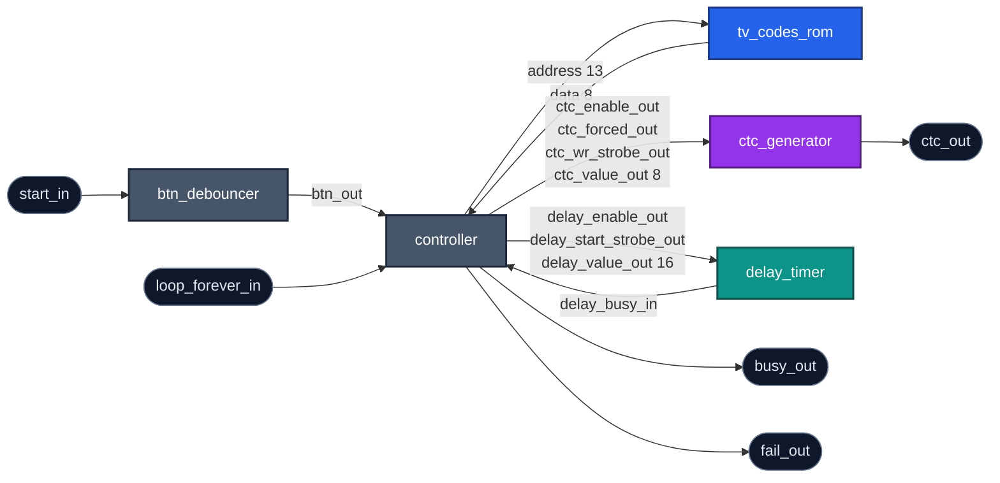
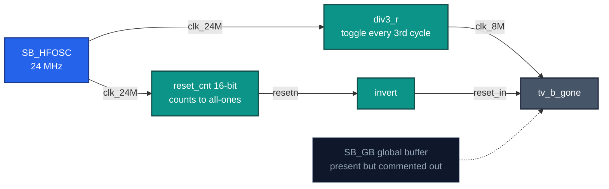

# Architecture

How the pieces fit together: what is portable and what is not, which block does
what, and how a byte of the code table becomes light.

Individual module ports and parameters are in [modules.md](modules.md); the
sequencing is in [controller-fsm.md](controller-fsm.md).

- [Two layers](#two-layers)
- [Inside the core](#inside-the-core)
- [The four interfaces](#the-four-interfaces)
- [Clock and reset](#clock-and-reset)
- [Addressing the table](#addressing-the-table)

## Two layers

The design is two layers deep at the top: a board wrapper and a portable core.

`pico_ice` is the wrapper. It holds every vendor primitive, pin name and
board-specific polarity in the project, and supplies the core with a clock, a
reset and signals in the polarity the core expects.

`tv_b_gone` is the core: seven ports, no vendor primitives, no board assumptions.
Moving to another FPGA or to an ASIC means replacing the wrapper.

The core does assume its clock rate. `CLK_MHZ` appears in `delay_timer` and
`btn_debouncer`, and the compare values in the code table are relative to the same
clock, so a change of frequency needs both updated. See
[porting.md](porting.md).

## Inside the core



**Figure D04** — The core and every signal between its blocks. Grey sequences,
blue stores, purple emits, teal measures time.

**`tv_codes_rom`** holds the code table and returns a byte in the same cycle the
address is presented.

**`ctc_generator`** produces the carrier, toggling its output at a rate set by a
compare value.

**`delay_timer`** measures burst and gap durations in 10 µs units and reports when
one has elapsed.

**`btn_debouncer`** samples the start button and emits one pulse per confirmed
press.

**`controller`** sequences all of it: reads the table, selects each duration, and
drives the other blocks. Twelve states and three counters.

Why the work is divided this way is covered in
[design-notes.md](design-notes.md).

## The four interfaces

The controller talks to everything through four groups of signals, and each group
has a different shape.

| Interface | Signals | Style |
| --- | --- | --- |
| Control and status | `start_in`, `loop_forever_in`, `busy_out`, `fail_out` | levels |
| Memory | `mem_address_out`, `mem_data_in` | combinational, same-cycle |
| Carrier | `ctc_enable_out`, `ctc_forced_out`, `ctc_wr_strobe_out`, `ctc_value_out` | level plus a one-cycle write strobe |
| Timing | `delay_enable_out`, `delay_start_strobe_out`, `delay_value_out`, `delay_busy_in` | strobe out, busy back |

The memory read completes within the cycle it is requested. The carrier settings
are levels that hold, and the status outputs are decoded straight from the state
register. The timing interface is the only one with a handshake: the controller
strobes in a value and waits for `delay_busy_in` to fall.

`ctc_generator` accepts a new compare value only while `ctc_enable_out` is low, so
the controller writes it between chirps rather than during one.

## Clock and reset



**Figure D05** — Everything in the wrapper, not the core.

The iCE40's internal oscillator supplies 24 MHz, and a counter divides it to the
8 MHz core clock. There is no PLL and no external crystal.

Reset comes from a 16-bit counter that increments until every bit is set and then
stops, holding the core in reset for the first 65536 clocks — about 2.7 ms after
configuration. It relies on the bitstream initialising the counter to zero.

The clock runs on ordinary routing. A global clock buffer is present in the
wrapper, commented out.

## Addressing the table

Two address registers cover the whole table.

`header_chirps_address_r` follows the record: it starts at the header, and once
the three header bytes are read it points at the first pair-table entry.
`index_byte_address_r` points at the index bytes further along.

A pair-table entry sits at `base + index × 4 + byte`, formed as a concatenation
rather than a product:

```systemverilog
mem_address_out = header_chirps_address_r + {6'b0, chirp_pair_index, byte_counter_r};
```

`chirp_pair_index` occupies bits [5:2] and `byte_counter_r` bits [1:0].

Which register drives the address depends on the state; the per-state table in
[controller-fsm.md](controller-fsm.md) lists all of them.

---

**Next:** [design-notes.md](design-notes.md) · **Unfamiliar term?**
[glossary.md](glossary.md)

**Why it is built this way:** [adr.md](adr.md) records the design decisions.
