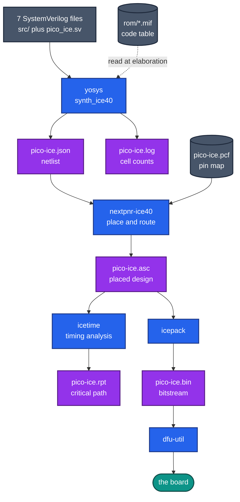

# Building and programming

How to turn the source into a bitstream and get it onto the board, and how to
read what the tools tell you on the way.

- [What you need](#what-you-need)
- [Building](#building)
- [The stages](#the-stages)
- [Make targets](#make-targets)
- [Choosing a code table](#choosing-a-code-table)
- [Linting](#linting)
- [Results](#results)
- [Reading the reports](#reading-the-reports)
- [Programming the board](#programming-the-board)

## What you need

One download covers it: the [OSS CAD
Suite](https://github.com/YosysHQ/oss-cad-suite-build), a prebuilt bundle of the
open-source FPGA toolchain. Unpack it, add its `bin` directory to `PATH`, and
every tool below is present.

| Tool | Job |
| --- | --- |
| `yosys` | Synthesis: SystemVerilog to a netlist of iCE40 cells |
| `nextpnr-ice40` | Place and route: cells to locations and wires |
| `icetime` | Timing analysis of the placed design |
| `icepack` | Packs the placed design into a bitstream |
| `dfu-util` | Loads the bitstream onto the board over USB |
| `verilator` | Lints the sources |

On Windows the suite runs under WSL or as a native build; the commands below are
the same either way.

## Building

```console
$ cd pico-ice
$ make pico-ice.bin
$ make prog
```

A clean build takes seconds.

## The stages



**Figure D31** — Grey is input, blue is a tool, purple is a file it produces.

Each stage answers one question.

**Synthesis** asks *what logic does this describe?* `yosys` reads the
SystemVerilog and produces a netlist of cells the iCE40 actually has: 4-input
look-up tables, flip-flops, carry cells. The code table enters here. `$readmemh`
reads the `.mif` while the design elaborates, so the table is baked into the
netlist rather than loaded at runtime.

**Place and route** asks *where does each cell go, and how are they wired?*
`nextpnr-ice40` gives every cell a physical location on the die and finds routes
between them, honouring the pin assignments in the `.pcf`.

**Timing analysis** asks *is it fast enough?* `icetime` walks the placed design
and reports its longest path.

**Packing** asks *what bytes configure the chip?* `icepack` turns the placed
design into the bitstream.

**Downloading** asks *how does it get there?* `dfu-util` sends the bitstream over
USB.

## Make targets

| Target | Runs | Produces |
| --- | --- | --- |
| `pico-ice.json` | `yosys` | netlist and log |
| `pico-ice.asc` | `nextpnr-ice40` | placed design |
| `pico-ice.bin` | `icetime`, then `icepack` | timing report and bitstream |
| `prog` | `dfu-util` | loads the board |
| `lint` | `verilator --lint-only` | warnings only |
| `clean` | `rm` | removes all five artifacts |

`make` with no target builds `pico-ice.json`, the first rule in the file, and
stops there. Ask for `pico-ice.bin` or `prog` to go all the way.

Two quirks are worth knowing. `lint` is declared as depending on `pico-ice.json`,
so running it triggers a full synthesis first, although the linter does not use
the netlist. And only `prog` is marked `.PHONY`, so `lint` and `clean` would be
skipped if files by those names ever appeared in the directory.

## Choosing a code table

A build compiles one code table, fixed at synthesis time. `tv_codes_rom` selects
it through `INIT_FILE` and `SIZE`, which change together — see
[porting.md](porting.md) for the values and the address-width limit.

## Linting

```console
$ make lint
```

`verilator --lint-only` parses the design and reports style and correctness
warnings without building anything. It catches unused signals, width mismatches
and unintended latches, which are the mistakes that synthesise quietly and
misbehave later.

One warning is suppressed on purpose. `tv_b_gone` wraps its ROM instance in

```systemverilog
/* verilator lint_off UNUSEDSIGNAL */
```

because `address_overflow` is brought out of `tv_codes_rom` and not used at the
top level.

## Results

Both regional tables have been built with **Yosys 0.68+58**, zero warnings. The
timing report of each build, `pico-ice.rpt`, is kept in
[`../pico-ice/eu/`](../pico-ice/eu/) and [`../pico-ice/na/`](../pico-ice/na/).

| Cell | EU table | NA table |
| --- | --- | --- |
| `SB_LUT4` | 3664 | 3842 |
| `SB_CARRY` | 127 | 126 |
| Flip-flops, all `SB_DFF*` variants | 181 | 181 |
| `SB_HFOSC` | 1 | 1 |
| `SB_RAM40_4K` | 0 | 0 |

That is 69 % of the UP5K's 5280 look-up tables for EU and 73 % for NA. The
bitstream is 104 090 bytes either way: an iCE40 configuration image is a fixed
length, and only its contents change.

Everything outside the code table is identical between the two builds — the same
181 flip-flops, one carry cell apart — so the difference of 178 look-up tables is
the larger table alone.

The code table accounts for nearly all of it. The four leaf modules use 88 LUTs
between them — `delay_timer` 41, `btn_debouncer` 24, `ctc_generator` 23 — and the
controller and the table share the rest.

The table is built from logic rather than block RAM, which is what the zero in the
last row means. `tv_codes_rom` reads combinationally, and block RAM on this family
has a registered read port, so `yosys` turns the array into a mux tree over
constant data and minimises it into look-up tables. The log states it directly:

```
Mapping memory \tv_gone.rom.rom_array in module \pico_ice:
  created 4740 $dff cells and 0 static cells of width 8.
  read interface: 0 $dff and 8191 $mux cells.
```

8191 is a full binary mux tree across 13 address bits. The 4740 registers hold
constant data and fold away, leaving the tree behind.

Both regional tables produce the same 8191-node tree, because both fit 13 address
bits. That is why the NA table costs only 178 more look-up tables than the EU one
despite holding 580 more bytes: the decode tree is the bulk of the cost and it is
the same size in both, so only the data contents differ.

Timing, from `icetime`:

| | EU table | NA table |
| --- | --- | --- |
| Critical path | 69.59 ns | 70.36 ns |
| Implied maximum | 14.37 MHz | 14.21 MHz |
| Path endpoint | `delay_on_off_r`, through the code-table logic | same |

The 8 MHz core clock has a period of 125 ns, so both builds have about 1.8 times
the margin required. `icetime` also prints `max_span_hack is enabled`, meaning its
estimate is deliberately pessimistic.

The critical path runs through the table because the read is combinational: an
address enters the mux tree and the byte has to arrive before the next clock edge.

## Reading the reports

**Cell counts** are at the end of `pico-ice.log`, under the last
`Printing statistics`. The `=== design hierarchy ===` block below repeats them
including submodules. A line for `SB_RAM40_4K` appears only when block RAM is
used.

**Memory decisions** appear earlier, at the `MEMORY_LIBMAP` and `MEMORY_MAP`
passes. `MEMORY_MAP` in the log means an array became logic.

**Timing** is the last two lines of `pico-ice.rpt`:

```
Total number of logic levels: 17
Total path delay: 69.59 ns (14.37 MHz)
```

The lines above them trace the path signal by signal, which shows where the delay
is rather than only how much of it there is.

Two numbers in the Makefile do not match the 8 MHz clock. `nextpnr-ice40` is asked
for `--freq 10`, a target above the real clock, and `icetime` is given `-c 12`, a
12 ns constraint it reports against but does not enforce. Neither changes the
outcome: the design meets 8 MHz either way.

## Programming the board

```console
$ make prog
```

which runs

```console
$ dfu-util --alt 1 --download pico-ice.bin --device 1209:b1c0
```

Put the board in DFU mode first, and check that `1209:b1c0` matches what your
system reports. `dfu-util --list` shows connected devices.

| Symptom | Likely cause |
| --- | --- |
| `No DFU capable USB device available` | Board not in DFU mode, or a cable that carries power only |
| Device listed, download fails | Wrong `--alt` setting; alt 1 is the FPGA bitstream |
| Loads, nothing happens | Check the IR LED wiring; the carrier is invisible. The status LED follows `busy_out`. |
| Status LED never lights | The button is active low on this board, and `start_in` receives its inverse |

To flash without building anything, use a released bitstream from
[`bitstreams/`](../bitstreams/).

---

**Previous:** [porting.md](porting.md) · **Unfamiliar term?**
[glossary.md](glossary.md)

**Why it is built this way:** [adr.md](adr.md) records the design decisions.
