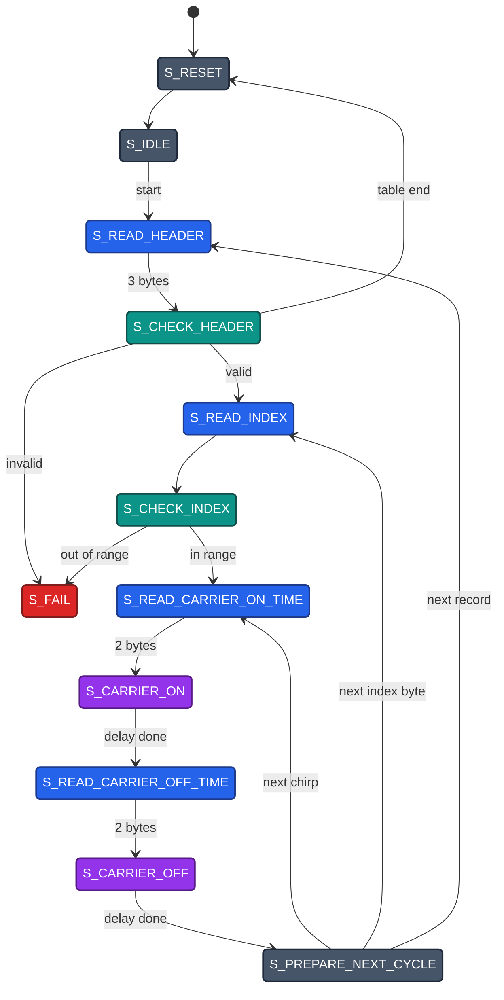
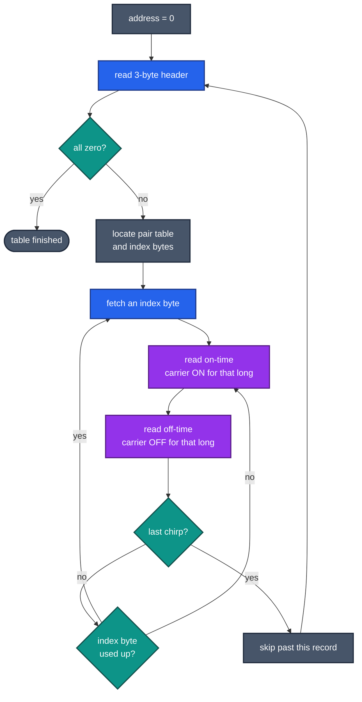
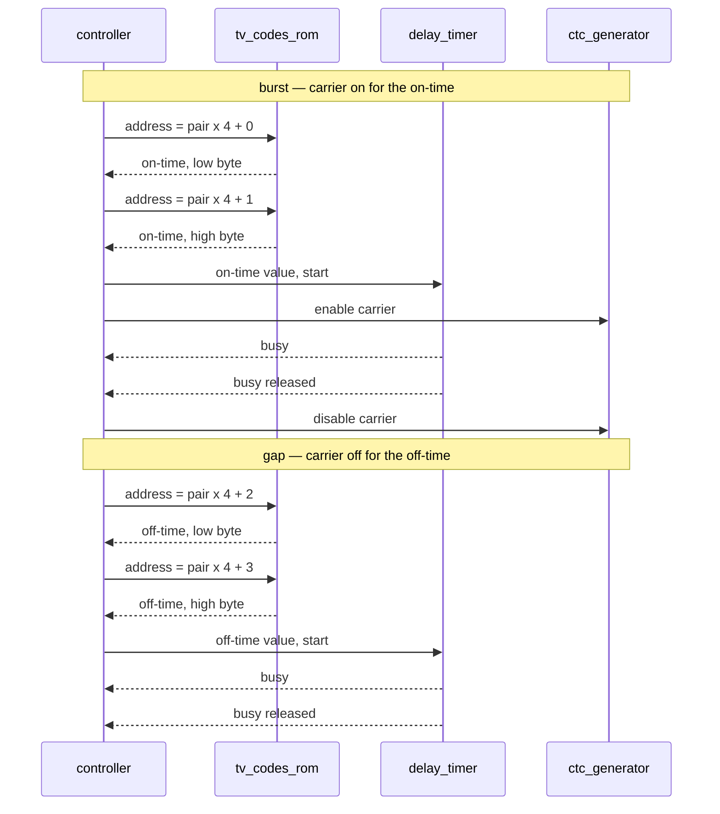
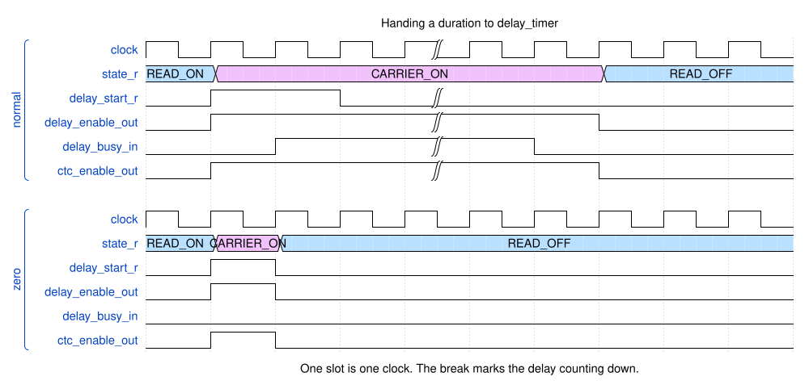

# The controller state machine

The controller is the part that reads the code table and plays it. It holds no
instructions and runs no program: it is twelve states, three counters and a
handful of address registers, and it does in hardware what the original firmware
did in a loop.

This page assumes you know the layout of a record — see
[rom-format.md](rom-format.md).

- [Firmware without a CPU](#firmware-without-a-cpu)
- [The state machine](#the-state-machine)
- [Per-state reference](#per-state-reference)
- [The same thing as a program](#the-same-thing-as-a-program)
- [One chirp, end to end](#one-chirp-end-to-end)
- [The delay handshake](#the-delay-handshake)
- [Starting, looping and stopping](#starting-looping-and-stopping)
- [What the FSM costs](#what-the-fsm-costs)

## Firmware without a CPU

The AVR original walks the code table with a program: load a pointer, read a byte,
call a delay routine, branch back. Every one of those steps costs instructions,
and the processor exists to execute them.

Here there is no processor. `state_r` holds which step the design is on, a `case`
statement says what each step does and which step follows, and the whole thing
advances one step per clock edge. What was a loop becomes a cycle in a state
diagram; what were local variables become registers.

The pieces that do the work sit outside the controller and are driven by it: the
ROM supplies bytes, `delay_timer` measures the burst and gap durations, and
`ctc_generator` produces the carrier. The controller decides *when*, never *how*.

## The state machine

**Figure D18** — All twelve states, coloured by what they do: **blue** reads the
ROM, **purple** drives the IR LED, **teal** validates what was read, **grey**
sequences, **red** is the dead end. Edge labels are abbreviated; the full
conditions are in the table below.

Three phases repeat, nested inside one another.

**Fetch a record.** `S_READ_HEADER` reads the three header bytes, one per clock.
`S_CHECK_HEADER` then decides among three outcomes: an all-zero header means the
table is finished and the machine returns to `S_RESET`; a header with a sane
`pairs_num`, `chirps_num` and `index_bits_num` starts playback; anything else goes
to `S_FAIL`.

**Emit a chirp.** `S_READ_INDEX` pulls in an index byte, `S_CHECK_INDEX` confirms
the unpacked index actually points inside the pair table, and the four states after
it read a duration and wait it out — twice, once for the on-time and once for the
off-time. The carrier runs only during `S_CARRIER_ON`.

**Advance.** `S_PREPARE_NEXT_CYCLE` decides what comes next: another chirp from the
index byte already loaded, another chirp needing a fresh index byte, or the end of
this record and on to the next header.

Reset is not drawn as twelve arrows. `reset_in` returns the machine to `S_RESET`
from any state, and `S_FAIL` is the one state with no way out except that.

## Per-state reference

The table to keep beside you while reading
[`controller.sv`](../src/controller.sv). *Address* is what the combinational mux
drives onto `mem_address_out` in that state; states that read nothing drive 0.

| State | ROM address | Writes | Outputs | Cycles | Leaves when |
| --- | --- | --- | --- | --- | --- |
| `S_RESET` | — | clears every register | `busy` | 1 | always |
| `S_IDLE` | — | — | none | waits | `start_in` or `loop_forever_in` |
| `S_READ_HEADER` | `header_chirps_address_r` | `header_r[byte_counter_r]`, address++, counter-- | `busy` | 3 | `byte_counter_r == 0` |
| `S_CHECK_HEADER` | `header_chirps_address_r` | `index_byte_address_r`, `chirps_counter_r`, `index_bit_offset_r` | `busy` | 1 | always, three ways |
| `S_READ_INDEX` | `index_byte_address_r` | `index_vector_r`, `byte_counter_r = 0` | `busy`, `ctc_wr_strobe` | 1 | always |
| `S_CHECK_INDEX` | — | — | `busy` | 1 | always, two ways |
| `S_READ_CARRIER_ON_TIME` | `header_chirps_address_r + index×4 + byte_counter_r` | `delay_on_off_r`, `delay_start_r`, counter++ | `busy` | 2 | `byte_counter_r == 1` |
| `S_CARRIER_ON` | — | `delay_start_r` cleared | `busy`, `delay_enable`, `ctc_enable` or `ctc_forced` | 2 + delay | delay elapsed |
| `S_READ_CARRIER_OFF_TIME` | `header_chirps_address_r + index×4 + byte_counter_r` | `delay_on_off_r`, `delay_start_r`, counter++ | `busy` | 2 | `byte_counter_r == 3` |
| `S_CARRIER_OFF` | — | `delay_start_r` cleared | `busy`, `delay_enable` | 2 + delay | delay elapsed |
| `S_PREPARE_NEXT_CYCLE` | — | `chirps_counter_r`, `index_bit_offset_r`, one address register | `busy` | 1 | always, three ways |
| `S_FAIL` | — | — | `busy`, `fail` | terminal | `reset_in` only |

A duration of zero is the exception to the *Cycles* column: `S_CARRIER_ON` and
`S_CARRIER_OFF` leave after a single cycle, because `delay_timer` never reports
busy for a zero count and waiting for it would hang.

`busy_out` is simply `state_r != S_IDLE`, so it covers `S_RESET` as well as
playback. `fail_out` is `state_r == S_FAIL`, and once set it stays set until reset.

### One counter, three jobs

`byte_counter_r` is two bits wide and used for three different things:

| Where | Counts | Purpose |
| --- | --- | --- |
| `S_READ_HEADER` | 2 → 1 → 0 | which header byte is being read |
| `S_READ_CARRIER_ON_TIME` | 0 → 1 | low then high byte of the on-time |
| `S_READ_CARRIER_OFF_TIME` | 2 → 3 | low then high byte of the off-time |

The last two also serve as the bottom two bits of the ROM address, which is what
makes a pair-table entry `index × 4 + byte_counter_r`. After the off-time's high
byte the counter increments from 3 and wraps to 0, leaving it correct for the next
chirp's on-time read without any explicit reset.

## The same thing as a program

Read as control flow rather than as states, the machine is two nested loops: an
outer one over records, an inner one over the chirps of a record.

**Figure D20** — The happy path. Same colours as D18. The two failure exits are
left out here; they are in D18.

The inner loop has two ways round it, which is the only part of the shape that is
not obvious from the record layout. Most chirps take the short path — the index
for the next chirp is still inside the byte already loaded, so playback goes
straight back to reading a duration. Every few chirps that byte runs out and the
long path fetches another.

## One chirp, end to end

Four blocks are involved in every chirp. The controller drives all of them; none
of them talk to each other.

**Figure D21** — One chirp. The burst and the gap are the same sequence twice; the
only difference is that the carrier is enabled for the first and not the second.

The carrier generator is loaded earlier than this, in `S_READ_INDEX`, because
`ctc_generator` only accepts a new compare value while it is disabled. Doing it
once per index fetch keeps it clear of the burst.

## The delay handshake

Starting a delay takes more than one signal, because `delay_timer` reports
`busy_out` combinationally and only loads a new value while it is *not* busy.

**Figure D22** — Handing a duration to the timer. Top: a normal delay. Bottom: a
duration of zero.

In the normal case the controller raises `delay_start_r` as it enters
`S_CARRIER_ON`. The timer is not busy yet, so it loads the value; one clock later
`busy_out` rises. The controller sees `start` and `busy` together, drops `start`,
and then waits for `busy` to fall — which is the condition to move on.

Both halves of that are needed. Dropping `start` immediately would risk the load
never happening; leaving it high would reload the timer as soon as it finished.

A duration of zero takes the other path. `busy_out` would never rise for a zero
count, so waiting for it would hang the machine. `S_CARRIER_ON` therefore tests
`delay_on_off_r` for zero first and leaves after a single clock, and the carrier is
enabled for that one clock rather than not at all.

## Starting, looping and stopping

`start_in` arrives already debounced, as a pulse one sample period long — 10 ms at
8 MHz. `S_IDLE` samples it, and `busy_out` rises immediately, so holding the button
down does not queue a second run: by the time the machine is back in `S_IDLE` the
debouncer's shift register reads all ones and its output is low again.

`loop_forever_in` is sampled in the same place, as a level. With it high the
machine leaves `S_IDLE` again the moment it arrives there, so reaching the
terminator starts the whole table over. It is not debounced and not synchronised —
a glitch on it costs an extra playback, nothing worse.

Reaching the terminator is the normal end: `S_CHECK_HEADER` sees an all-zero
header, returns to `S_RESET`, which clears every register and drops into `S_IDLE`
with `busy_out` low.

`S_FAIL` is the abnormal end. Nothing leaves it except `reset_in`, and `fail_out`
stays high while the machine sits there.

## What the FSM costs

Outside the delays themselves the controller spends about seven clocks per chirp:
one to check the index, two to read the on-time, two to read the off-time, one to
advance, and one more when an index byte has to be fetched. Header reads add three
clocks per record.

At 8 MHz that is under a microsecond per chirp, against chirps that run from tens
of microseconds to a few milliseconds. The cycle counts are fixed regardless of
clock rate, so the overhead stays proportionally small at any speed the design
runs at.

---

**Previous:** [rom-format.md](rom-format.md) · **Unfamiliar term?**
[glossary.md](glossary.md)

**Why it is built this way:** [adr.md](adr.md) records the design decisions.
