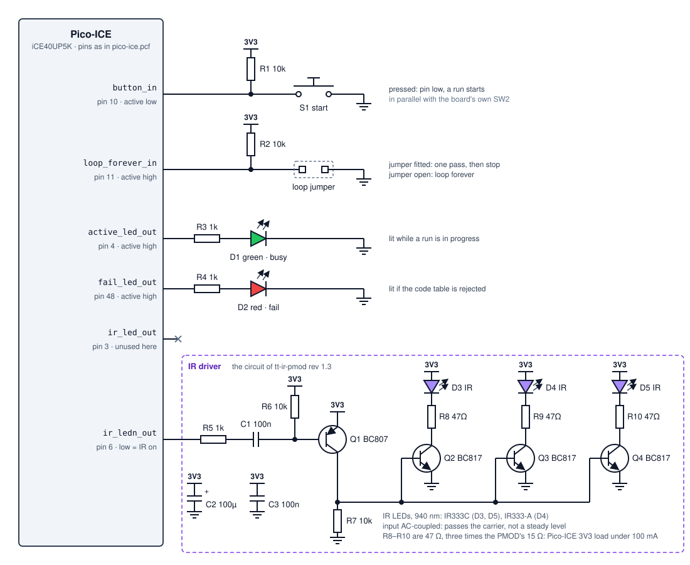
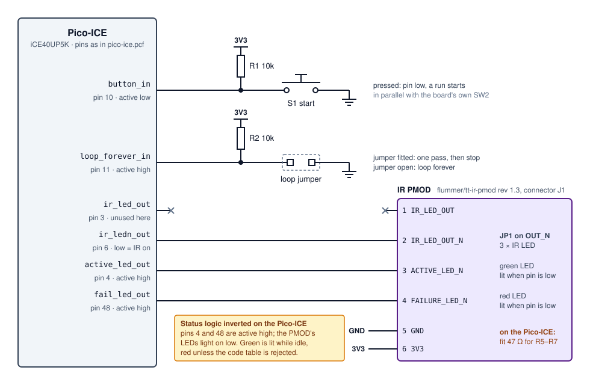

# Wiring the hardware

What to connect to the Pico-ICE, and how: the start button, the loop jumper, the
two status LEDs and the IR transmitter. Two ways to build it are shown: from
discrete parts, or with the Tiny Tapeout IR PMOD doing the IR drive and the status
LEDs.

- [Built from discrete parts](#built-from-discrete-parts)
- [Built with the IR PMOD](#built-with-the-ir-pmod)
- [Pin map](#pin-map)
- [Inputs](#inputs)
- [Status LEDs](#status-leds)
- [The IR driver](#the-ir-driver)

Pin numbers throughout are iCE40 package pins, as used in
[`pico-ice.pcf`](../pico-ice/pico-ice.pcf). The [Pico-ICE
pinout](http://pico-ice.tinyvision.ai/md_pinout.html) shows where each one sits on
the board's headers. 3V3 and GND come from the Pico-ICE.

## Built from discrete parts

**Figure D34a** — Every part outside the Pico-ICE. The IR driver in the dashed box
is the circuit of the [Tiny Tapeout IR PMOD](https://github.com/flummer/tt-ir-pmod),
revision 1.3, drawn out in full.

## Built with the IR PMOD

**Figure D34b** — The same circuit with the IR PMOD in place of the IR driver and
the two status LEDs. The button and the loop jumper are unchanged. On the
Pico-ICE, the PMOD's three 15 Ω LED resistors, R5–R7, are replaced with 47 Ω.

The PMOD's status LEDs light when their pin is low, and `active_led_out` and
`fail_led_out` are active high. Wired this way, the green LED is lit while the
gadget is idle and goes dark during a run, and the red LED is lit unless the code
table has been rejected.

## Pin map

| Signal | Pin | Direction | Active | Discrete build (D34a) | PMOD build (D34b) |
| --- | --- | --- | --- | --- | --- |
| `button_in` | 10 | in | low | button to GND, 10 kΩ pull-up | same |
| `loop_forever_in` | 11 | in | high | jumper to GND, 10 kΩ pull-up | same |
| `active_led_out` | 4 | out | high | 1 kΩ and green LED to GND | PMOD pin 3, `ACTIVE_LED_N` |
| `fail_led_out` | 48 | out | high | 1 kΩ and red LED to GND | PMOD pin 4, `FAILURE_LED_N` |
| `ir_ledn_out` | 6 | out | low | IR driver input | PMOD pin 2, `IR_LED_OUT_N` |
| `ir_led_out` | 3 | out | high | unused | unused |
| `clk_ext` | 35 | in | — | unused; clock from the RP2040 | same |
| `led_red`, `led_green`, `led_blue` | 41, 40, 39 | out | low | the board's RGB LED, held off | same |

## Inputs

**Start.** `button_in` idles high through its pull-up and goes low while the
button is pressed. The wrapper inverts it, and the core debounces it, so one press
starts exactly one run. Pin 10 is also wired to the Pico-ICE's own push button,
`SW2`, so either button starts a run.

**Loop.** `loop_forever_in` is a level, read each time the controller is idle.
With the jumper fitted the pin is held low, and the table plays once per button
press. With the jumper removed the pull-up holds it high, and the table restarts
every time it finishes, without the button. The input is not debounced, so a
jumper rather than a button suits it.

## Status LEDs

`active_led_out` follows `busy_out`: high from the moment a run starts until the
table ends. `fail_led_out` follows `fail_out`: high only if the controller rejects
the code table, and then it stays high until the FPGA is reconfigured.

In the discrete build each LED goes from its pin, through a 1 kΩ resistor, to GND,
and lights while its output is high.

## The IR driver

The driver takes `ir_ledn_out`, the inverse of the carrier, which idles high with
the LEDs off and pulls low for each carrier pulse. The IR PMOD selects this input
with its jumper JP1, set to `OUT_N`.

**Input coupling.** The signal passes through R5 (1 kΩ) and C1 (100 nF) to the
base of Q1. R6 (10 kΩ) holds that base at 3V3, so Q1 is off while the input is
steady. Each falling edge pulls the base down through C1 and switches Q1 on.
The coupling passes the carrier, and a steady level does not hold the LEDs on.

**Output stage.** Q1, a BC807 PNP transistor, sources current from 3V3 into the
bases of Q2, Q3 and Q4, three BC817 NPN transistors. R7 (10 kΩ) pulls those bases
to GND when Q1 is off. Each NPN switches one IR LED, in series with its resistor,
between 3V3 and GND.

**LEDs and current.** The three LEDs are 940 nm parts: two IR333C and one
IR333-A. The LED resistors set the load on the 3V3 rail, and the right value
depends on the board supplying it:

| Board | LED resistors | Load while transmitting |
| --- | --- | --- |
| Pico-ICE | 47 Ω, three times the PMOD's value | under 100 mA in total |
| Tiny Tapeout demo board | 15 Ω, as fitted on the PMOD | up to about 100 mA per LED; the board supplies 300 mA |

C2 (100 µF) and C3 (100 nF) steady the 3V3 rail during the bursts.

---

**Previous:** [build-and-program.md](build-and-program.md) · **Unfamiliar term?**
[glossary.md](glossary.md)

**Why it is built this way:** [adr.md](adr.md) records the design decisions.
