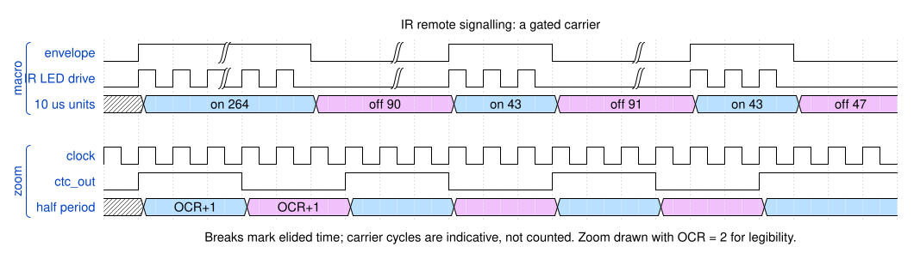

# How IR remotes work

Enough background to follow the rest of this project. If you already know what a
38 kHz carrier is and why remote codes are lists of on/off times, skip to
[rom-format.md](rom-format.md).

## The problem: infrared is a noisy channel

A remote control talks to a television with an infrared LED — light just beyond
what the eye can see. The trouble is that plenty of other things emit infrared
too. Sunlight does. So do incandescent bulbs, candles, heaters, and the mains
flicker of fluorescent tubes and some LED lamps.

A receiver that simply measured "is there infrared light?" would sit in a room
that is already flooded with it.

## The fix: modulate, then filter

Instead of holding the LED on, the transmitter switches it on and off very fast —
typically between 30 and 60 kHz, most often around 38 kHz. That rapid on/off
switching is the **carrier**.

The receiver is built to match. It contains a filter tuned to that frequency, so
it responds to light flickering at 38 kHz and ignores light that is steady or
varying slowly. Sunlight is steady. Mains flicker is 100 or 120 Hz, thousands of
times too slow. Nothing else in the room flickers at 38 kHz.

This is why pointing a remote at a TV works in bright daylight, and why the
carrier frequency has to be roughly right: a receiver tuned to 38 kHz responds far
more weakly to a transmitter running at 56 kHz.

## Carrying a message: the envelope

The carrier makes the signal *visible* to the receiver, but by itself carries no
information — it is the same flicker whether you press *volume up* or *power*.

The message lives in **when the carrier is switched on and off**. The transmitter
gates the carrier into bursts separated by gaps, and the pattern of their
durations encodes the command. That pattern is the **envelope**.

**Figure D02** — The top pair of traces shows the envelope and the resulting LED
drive; the lower pair zooms in on the carrier itself. Breaks mark elided time.

A receiver strips the carrier back off and hands the decoder just the envelope —
the same shape the transmitter started with. From that point on, the command is
simply a sequence of durations.

Throughout this project a single on-burst plus the gap that follows it is called a
**chirp**, and one complete command — a carrier frequency plus its list of chirps —
is called a **code**.

Not every code uses a carrier. A few send bursts of unmodulated light, holding the
LED steadily on for the whole burst instead of flickering it; 16 of the 138
European codes here do that.

## What a code actually contains

Take the first code in the European table. Its carrier is 35.7 kHz — quoted at the
8 MHz core clock — and it sends 40 chirps. The first four are:

| Chirp | On | Off |
| --- | --- | --- |
| 1 | 2.64 ms | 0.90 ms |
| 2 | 0.43 ms | 0.91 ms |
| 3 | 0.43 ms | 0.47 ms |
| 4 | 0.43 ms | 0.47 ms |

The long opening burst is a leader. It gives the receiver's automatic gain control
time to settle before any data arrives, so the bursts that follow are read
cleanly. The short bursts after it carry the actual bits: in chirps 2 to 4 the
on-times are identical and only the gaps differ, so it is the *gap* lengths that
distinguish one bit from another.

Durations in this project are stored in units of 10 µs, so those four chirps are
held as 264/90, 43/91, 43/47 and 43/47.

## Why the same durations keep repeating

Look at the table again: `0.43 ms` appears three times, `0.47 ms` twice. That is
typical. A protocol uses a small alphabet of durations — often just a leader, a "0", a "1" and a trailing gap — and then repeats them in different
orders to spell out different commands.

That repetition is worth exploiting. Storing four bytes of timing for every one of
40 chirps would cost 160 bytes, when the code only ever uses seven distinct
duration pairs. Storing each pair once and referring to it by a small number
brings the same code down to 46 bytes.

That is exactly how the code table here is built, and
[rom-format.md](rom-format.md) covers the encoding in full.

## Why so many codes

There is no universal "off" command. Manufacturers picked their own carrier
frequencies, their own timings and their own command numbers, and a television
ignores anything that does not match what it expects.

So a device that has to turn off an unknown television cannot be clever — it has
to be thorough. It transmits code after code, one manufacturer at a time, until
one of them lands. That is what this project does: around 140 codes for Europe,
140 for North America, sent back to back in about 24 seconds.

---

**Next:** [rom-format.md](rom-format.md) specifies how those codes are packed into
the ROM.

**Unfamiliar term?** [glossary.md](glossary.md).
