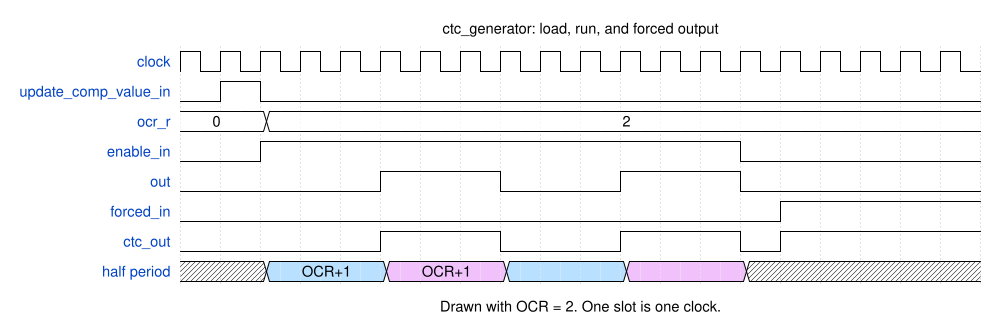
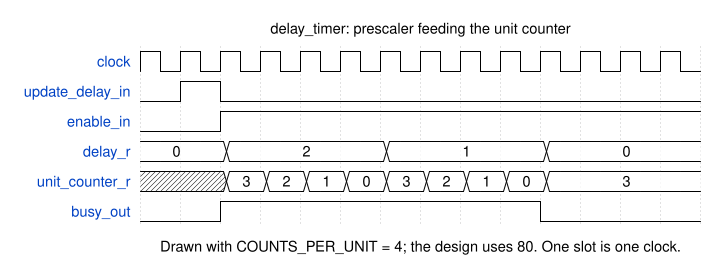
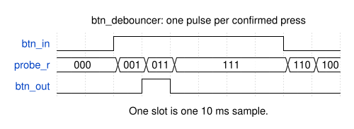

# Module reference

Every module in the design, in the order a signal passes through them. Each entry
gives what the module is for, its parameters and ports, and the behaviour worth
knowing before you instantiate or change it.

The controller has a page of its own — see
[controller-fsm.md](controller-fsm.md).

- [tv_b_gone](#tv_b_gone) — the portable core
- [tv_codes_rom](#tv_codes_rom) — the code table
- [ctc_generator](#ctc_generator) — the carrier
- [delay_timer](#delay_timer) — burst and gap durations
- [btn_debouncer](#btn_debouncer) — the button
- [pico_ice](#pico_ice) — the board wrapper

## tv_b_gone

The whole gadget, with nothing board-specific in it. Give it a clock, a reset and
a start signal, and it drives one output that turns an IR LED on and off.

**Ports**

| Port | Dir | Meaning |
| --- | --- | --- |
| `clock_in` | in | Core clock. Everything is synchronous to its rising edge. |
| `reset_in` | in | Synchronous reset, active high. |
| `start_in` | in | Begins a run. Already debounced. |
| `loop_forever_in` | in | While high, the table restarts as soon as it finishes. |
| `busy_out` | out | High from the moment a run starts until it ends. |
| `fail_out` | out | High if the controller rejected the code table. |
| `ctc_out` | out | Drives the IR LED. |

Internally it wires five modules together: the debouncer feeds `start_in` to the
controller, the controller addresses the ROM and drives the carrier generator and
the delay timer. It holds no logic of its own beyond that wiring.

Two local parameters set the interface widths: `CTC_WIDTH` is 8, matching the
one-byte compare value in a record header, and `DELAY_WIDTH` is 16, matching the
two-byte durations in a pair table.

The ROM address is a fixed 13 bits, which spans either regional code table. The
combined table takes 14 — see [rom-format.md](rom-format.md).

Source: [`src/tv_b_gone.sv`](../src/tv_b_gone.sv)

## tv_codes_rom

The code table, held in a read-only array loaded from a hex file at elaboration.

**Parameters**

| Parameter | Default | Meaning |
| --- | --- | --- |
| `SIZE` | 4740 | Array depth in bytes. Sets the address width. |
| `DATA_WIDTH` | 8 | Bits per entry. |
| `INIT_FILE` | `../rom/eu_tv_codes_rom.mif` | Hex file loaded by `$readmemh`. |
| `ADDRESS_BITS` | `$clog2(SIZE)` | Derived, not set by hand. |

**Ports**

| Port | Dir | Width | Meaning |
| --- | --- | --- | --- |
| `address` | in | `ADDRESS_BITS` | Byte to read. |
| `data` | out | `DATA_WIDTH` | Contents of that byte. |
| `address_overflow` | out | 1 | High when `address >= SIZE`. |

The read is **combinational**: `data` follows `address` within the same clock
cycle, with no enable and no latency. That is what lets every read state in the
controller be a single cycle.

`SIZE` and `INIT_FILE` must be changed together, and `SIZE` must be at least as
large as the file. Rounding it up past the terminator is deliberate; the entries
beyond the data are never read.

Addresses at or above `SIZE` return zero rather than an undefined value.
`address_overflow` reports the condition, and the top level leaves it
unconnected.

Source: [`src/tv_codes_rom.sv`](../src/tv_codes_rom.sv)

## ctc_generator

Produces the carrier by toggling an output every time a counter reaches a compare
value — the same behaviour as an AVR timer in CTC mode, which is where the name
comes from.

**Parameters**

| Parameter | Default | Meaning |
| --- | --- | --- |
| `WIDTH` | 8 | Width of the counter and the compare register. |

**Ports**

| Port | Dir | Meaning |
| --- | --- | --- |
| `clock_in` | in | Core clock. |
| `reset_in` | in | Synchronous reset, active high. |
| `enable_in` | in | While high, the counter runs and the output toggles. |
| `forced_in` | in | Output level while `enable_in` is low. |
| `compare_value_in` | in | New compare value. |
| `update_comp_value_in` | in | Loads `compare_value_in`. |
| `ctc_out` | out | The carrier. |

**Figure D25** — Loading a compare value, running, and the forced output.

The counter runs from 0 up to the compare value inclusive, so a half period is
`compare + 1` clocks and a full period is `2 × (compare + 1)`.

**The compare value only loads while `enable_in` is low.** A write during a burst
is ignored, so the controller does it between chirps. Loading also clears the
counter, which starts each new code from a known point.

`forced_in` covers codes with no carrier at all. When `enable_in` is low the
output is `forced_in` rather than the toggling flip-flop, so holding `forced_in`
high drives the LED steadily on for the length of a burst.

The toggle flip-flop keeps its value while disabled, so a burst resumes the
carrier where the previous one left off. Nothing in IR reception depends on that
phase.

Source: [`src/ctc_generator.sv`](../src/ctc_generator.sv)

## delay_timer

Measures a burst or gap. Counts a number of 10 µs units, which is how durations
are stored in the code table.

**Parameters**

| Parameter | Default | Meaning |
| --- | --- | --- |
| `WIDTH` | 16 | Width of the unit count, matching a pair-table duration. |
| `UNIT_COUNTS_US` | 10 | Microseconds per unit. |
| `CLK_MHZ` | 8 | Core clock in MHz. |

`COUNTS_PER_UNIT` is `CLK_MHZ × UNIT_COUNTS_US`, so 80 clocks per unit with the
defaults. **`CLK_MHZ` must match the actual clock**, or every duration in every
code comes out wrong by the same factor.

**Ports**

| Port | Dir | Meaning |
| --- | --- | --- |
| `clock_in` | in | Core clock. |
| `reset_in` | in | Synchronous reset, active high. |
| `enable_in` | in | While high, the timer counts. |
| `delay_in` | in | Number of units to wait. |
| `update_delay_in` | in | Loads `delay_in`. |
| `busy_out` | out | High while the delay is still running. |

**Figure D27** — Two counters in series: the prescaler rolls over, and each
rollover takes one off the unit count.

`busy_out` is combinational — `delay_r != 0 && enable_in` — so it responds in the
same cycle that `enable_in` changes, and a new value can only be loaded while it
is low. That is what shapes the controller's start handshake.

A count of zero never raises `busy_out` at all. Anything waiting for it to fall
must handle that case separately.

At the default settings the range is 1 to 65535 units, or 10 µs to 655 ms.

Source: [`src/delay_timer.sv`](../src/delay_timer.sv)

## btn_debouncer

Turns a mechanical button into one clean event per press.

**Parameters**

| Parameter | Default | Meaning |
| --- | --- | --- |
| `PERIOD_MS` | 10 | Milliseconds between samples. |
| `CLK_MHZ` | 8 | Core clock in MHz. |

**Ports**

| Port | Dir | Meaning |
| --- | --- | --- |
| `clock_in` | in | Core clock. |
| `reset_in` | in | Synchronous reset, active high. |
| `btn_in` | in | Raw button level, active high. |
| `btn_out` | out | One pulse per confirmed press. |

The module runs on the core clock but samples the button far more slowly. A
free-running counter divides the clock by `CLK_MHZ × PERIOD_MS × 1000` — 80 000
clocks with the defaults — and raises an internal `enable` for **one clock** each
time it reaches zero. That is one sample every 10 ms; the other 79 999 clocks do
nothing but count.

Each sample shifts `btn_in` into a three-bit register, so the register holds the
last three samples, spanning 30 ms of real time.

**Figure D29** — A press seen across three samples. One slot is one sample, so the
whole figure covers about 100 ms. The core clock runs 80 000 times faster and is
not shown.

`btn_out` is high only for the pattern where the two most recent samples read high
and the one before them read low — a rising edge confirmed across two consecutive
samples.

Contact bounce is rejected because it happens far faster than the sample rate:
between one tick and the next, the input has settled.

**`btn_out` stays high for one whole sample period**, not one clock, because the
shift register only advances on a tick. Holding the button does not produce a
second pulse: the pattern moves on to all-ones and the output returns low until
the button is released and pressed again.

The cost is latency. A press is confirmed two samples after it happens, so up to
about 20 ms with the defaults.

Source: [`src/btn_debouncer.sv`](../src/btn_debouncer.sv)

## pico_ice

The board wrapper, and the only file containing anything specific to the iCE40 or
to the Pico-ICE board. Retargeting the design means replacing this file and
nothing else.

**Ports**

| Port | Dir | Meaning |
| --- | --- | --- |
| `clk_ext` | in | External clock input. Declared but unused; the design runs from the internal oscillator. |
| `led_red`, `led_green`, `led_blue` | out | Board RGB LED, driven high and left off. |
| `button_in` | in | Start button, **active low**. |
| `loop_forever_in` | in | Loop mode switch, active high. |
| `ir_led_out` | out | Carrier. |
| `ir_ledn_out` | out | Carrier, inverted. |
| `active_led_out` | out | Driven by `busy_out`. |
| `fail_led_out` | out | Driven by `fail_out`. |

It supplies what the core needs and cannot provide for itself:

**A clock.** `SB_HFOSC` gives 24 MHz, and a modulo-3 counter toggles `clk_8M` from
it. The timing parameters downstream assume an 8 MHz core clock.

**A reset.** A 16-bit counter increments from zero until all its bits are set,
holding `reset_in` high for the first 65536 clocks — about 2.7 ms — after
configuration.

**Polarity.** The board's button pulls low when pressed, so `start_in` gets
`!button_in`.

**Both output polarities.** `ir_ledn_out` is the inverse of `ir_led_out`. Connect
whichever suits your LED driver and leave the other unconnected — see
[hardware.md](hardware.md).

Source: [`pico-ice/pico_ice.sv`](../pico-ice/pico_ice.sv)

---

**Previous:** [controller-fsm.md](controller-fsm.md) · **Unfamiliar term?**
[glossary.md](glossary.md)

**Why it is built this way:** [adr.md](adr.md) records the design decisions.
