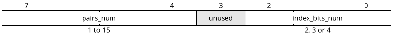
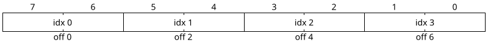
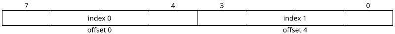
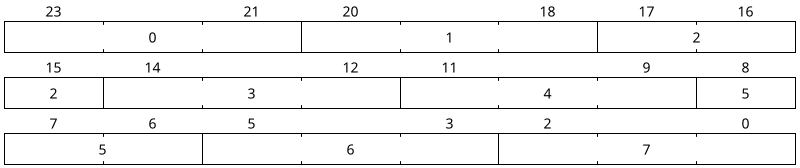
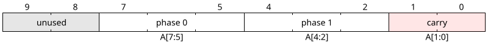
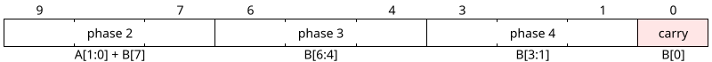
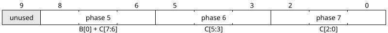
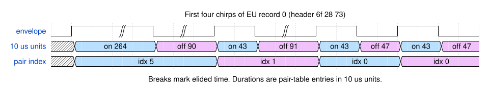

# The linear ROM format

The code table holds the power-off command for around 140 televisions in roughly
5 KB. This page specifies its layout completely, so you can read a table by hand,
generate a new one, or follow what
[`controller.sv`](../src/controller.sv) is doing.

If *carrier* and *envelope* are not yet familiar terms, read
[ir-primer.md](ir-primer.md) first. Everything below assumes you know that a code
is a carrier frequency plus a list of on/off burst durations.

- [Layout](#layout)
- [The header](#the-header)
- [The carrier value](#the-carrier-value)
- [The pair table](#the-pair-table)
- [Packed indices](#packed-indices)
- [Where a record ends](#where-a-record-ends)
- [A worked example](#a-worked-example)
- [Choosing a table](#choosing-a-table)
- [Generating a table](#generating-a-table)
- [Checking a table](#checking-a-table)

## Layout

Records run back to back from address 0. An all-zero header ends the table.

```
addr 0  ┌──────────────────────────┐
        │ record 0                 │  46 bytes
        ├──────────────────────────┤
        │ record 1                 │  40 bytes
        ├──────────────────────────┤
        │            ...           │
        ├──────────────────────────┤
        │ record 137               │
        ├──────────────────────────┤
   4736 │ 00 00 00                 │  terminator
        └──────────────────────────┘
```

Records are packed end to end with no alignment or padding, and vary from 12 to
74 bytes. There is no index and no length prefix: reaching record *n* means walking the *n* records
before it. Playback runs the table in order.

Each record has three regions:

```
        ┌──────────┬───────────────────────────┬──────────────────────┐
        │  header  │        pair table         │     index bytes      │
        │  3 bytes │   pairs_num × 4 bytes     │       varies         │
        └──────────┴───────────────────────────┴──────────────────────┘
```

For a record starting at `base`:

| Region | First address | Size |
| --- | --- | --- |
| Header | `base` | 3 |
| Pair table | `base + 3` | `pairs_num × 4` |
| Index bytes | `base + 3 + pairs_num × 4` | see [below](#where-a-record-ends) |

The pair table is a small dictionary of distinct on/off durations. The index bytes
are a packed list choosing which pair to emit for each burst. IR protocols reuse a
handful of durations, so storing each once and referring to it by a 2- or 3-bit
index is much cheaper than repeating it: a 40-burst code with 7 distinct pairs
costs 46 bytes this way, against 160 bytes if every burst carried its own
durations.

Every address in a record is `base` plus a constant or a shifted field, so the
controller walks the table with two address registers and an adder.

## The header

| Byte | Field | Meaning |
| --- | --- | --- |
| 0 | `frequency` | Carrier compare value — not a frequency in Hz. See [below](#the-carrier-value). |
| 1 | `chirps_num` | Number of on/off bursts. 2 to 136 in the shipped tables. |
| 2 | packed | `pairs_num` and `index_bits_num`. |

Byte 2 splits into two fields and one unused bit:



**Figure D10** — Header byte 2.

`pairs_num` gives the number of entries in the pair table. `index_bits_num` gives
the width of each packed index, and may be 2, 3 or 4.

Both fields carry deliberate headroom. The shipped tables use only 2 and 3 for
`index_bits_num`, and 2 to 8 for `pairs_num`, but the widths allow 4 and 15
respectively, so a future table can use them without a format change. Both fields
share a single byte, which a record allocates whether or not the extra range is
used.

The controller stores these bytes in `header_r` in **descending** index order:
file byte 0 goes to `header_r[2]`, byte 1 to `header_r[1]`, byte 2 to
`header_r[0]`. `byte_counter_r` counts down while reading them
([`controller.sv:42-61`](../src/controller.sv#L42-L61)). The file order in the
table above is the one that describes the data.

## The carrier value

Header byte 0 is the value the carrier generator counts to. `ctc_generator`
toggles its output on reaching it, so one carrier period spans two intervals of
`frequency + 1` clocks:

```
carrier Hz = f_clk / (2 × (frequency + 1))
frequency  = f_clk / (2 × carrier Hz) − 1
```

Storing the compare value rather than the frequency keeps a divider out of the
hardware — the byte goes straight into `ocr_r` — and makes the table
**clock-specific**. A table generated for one core clock is wrong for any other.

A value of **0 means no carrier**. The controller then drives `ctc_forced_out`
instead of `ctc_enable_out`, holding the LED on continuously for the burst
([`controller.sv:299-300`](../src/controller.sv#L299-L300)). Sixteen EU records
and two NA records use this.

The values in the EU table, quoted at `f_clk` = 8 MHz:

| `frequency` | Carrier | Records |
| --- | --- | --- |
| 0x00 = 0 | none | 16 |
| 0x43 = 67 | 58.8 kHz | 1 |
| 0x5f = 95 | 41.7 kHz | 4 |
| 0x63 = 99 | 40.0 kHz | 5 |
| 0x67 = 103 | 38.5 kHz | 72 |
| 0x6b = 107 | 37.0 kHz | 1 |
| 0x6f = 111 | 35.7 kHz | 9 |
| 0x73 = 115 | 34.5 kHz | 8 |
| 0x77 = 119 | 33.3 kHz | 10 |
| 0x7f = 127 | 31.3 kHz | 6 |
| 0x83 = 131 | 30.3 kHz | 6 |

38.5 kHz covers more than half the table, matching the standard 38 kHz receiver.
The NA table spans a wider range, 0x2f to 0x9b, led by 40.0 kHz (48 records) and
38.5 kHz (46).

## The pair table

`pairs_num` entries of 4 bytes: two little-endian 16-bit durations, on-time first.

```
        byte 0    byte 1    byte 2    byte 3
      ┌─────────┬─────────┬─────────┬─────────┐
      │ on  low │ on high │ off low │ off high│
      └─────────┴─────────┴─────────┴─────────┘
           └────────┘           └────────┘
          on-time, 16-bit      off-time, 16-bit
```

Durations are in **10 µs units**, matching the upstream firmware's
`delay_ten_us()` primitive, which is why the values are unchanged from the
original data. `delay_timer` prescales the core clock to produce that tick.
Sixteen bits reach 655.35 ms, well beyond the longest gap in any table.

Entry *i* lives at `base + 3 + i × 4`. The controller reads its four bytes by
driving that address with a 2-bit counter in the low bits
([`controller.sv:286`](../src/controller.sv#L286)).

A duration of 0 is legal and means "no wait": the controller skips the delay
rather than starting it, since `delay_timer` never raises `busy_out` for a zero
count ([`controller.sv:223`](../src/controller.sv#L223)).

## Packed indices

After the pair table comes one index per burst, `index_bits_num` bits each, with
no padding and no byte alignment. The controller unpacks them through a 10-bit
rolling window, `index_vector_r`, refilled one byte at a time.

Each fetch shifts the window and appends the new byte
([`controller.sv:200`](../src/controller.sv#L200)):

```systemverilog
index_vector_r <= {index_vector_r[1:0], mem_data_in[7:0]};
```

For 2- and 4-bit indices the carried bits are never used, since those widths divide
evenly into a byte. They matter only for the 3-bit case, covered
[below](#3-bits-per-index).

### 2 bits per index



**Figure D13** — Four indices per byte.

Indices divide evenly into bytes, so each is a plain 2-bit slice and the carried
bits are never used. `index_bit_offset_r` advances by 2, and a new byte is fetched
after offset 6. Used by 62 EU and 35 NA records.

### 4 bits per index



**Figure D12** — Two indices per byte, high nibble first.

Also divides evenly. The offset advances by 4 and a byte is fetched after offset
4. Supported for tables with up to 15 distinct pairs; the shipped tables do not
use it.

### 3 bits per index

Three bits do not divide into eight, so indices straddle byte boundaries and the
pattern repeats every three bytes — 24 bits holding exactly eight indices.



**Figure D14** — Eight 3-bit indices across three bytes. Top lane is byte 0,
middle byte 1, bottom byte 2. Index 2 straddles the byte 0 / byte 1 boundary and
index 5 straddles byte 1 / byte 2, each drawn as two boxes sharing a label.

For this width `index_bit_delta` is **1**, not 3
([`controller.sv:104`](../src/controller.sv#L104)), so `index_bit_offset_r`
counts phases 0 to 7 through the repeating window rather than bit positions.

#### How the window slides

The window is a fixed 10 bits, but a fetch shifts its contents by 8. Between
fetches the read position walks down 3 bits at a time; each fetch throws it back
up. That gives three window states, and each phase reads from one of them. Writing
`A`, `B`, `C` for three consecutive index bytes:

**After fetching A** — the window holds `A` in `[7:0]`, and phases 0 and 1 take
six of its bits from the top down. Two bits are left over.



**After fetching B** — the leftover two bits shift up to `[9:8]` and `B` lands in
`[7:0]`. Phase 2 now spans the join, taking both carried bits plus the top bit of
`B`; phases 3 and 4 continue down through `B`. One bit is left over.



**After fetching C** — the shift carries `B[1:0]` up, of which only `B[0]` is still
unread, so phase 5 spans the join and phases 6 and 7 finish `C`. Bit 9 holds
`B[1]`, already consumed by phase 4, and is ignored.



**Figure D15** — The three window states. After phase 7 the pattern repeats with a
fresh `A`.

The full phase list ([`controller.sv:110-122`](../src/controller.sv#L110-L122)):

| Phase | Window slice | Source bits | Fetch after |
| --- | --- | --- | --- |
| 0 | `[7:5]` | byte 0 [7:5] | no |
| 1 | `[4:2]` | byte 0 [4:2] | **yes** |
| 2 | `[9:7]` | byte 0 [1:0] + byte 1 [7] | no |
| 3 | `[6:4]` | byte 1 [6:4] | no |
| 4 | `[3:1]` | byte 1 [3:1] | **yes** |
| 5 | `[8:6]` | byte 1 [0] + byte 2 [7:6] | no |
| 6 | `[5:3]` | byte 2 [5:3] | no |
| 7 | `[2:0]` | byte 2 [2:0] | **yes** |

Used by 76 EU and 102 NA records.

## Where a record ends

The index region has no length field. Its size is whatever unpacking consumed:

1. One byte is fetched on entry to the region.
2. After each burst, another byte is fetched if the fetch column above is **yes**
   for the phase just used ([`controller.sv:93-101`](../src/controller.sv#L93-L101)).
3. The final burst never fetches — the controller moves to the next record instead
   ([`controller.sv:259-263`](../src/controller.sv#L259-L263)).
4. The next record starts one byte after the last index byte fetched.

The region occupies `ceil(chirps_num × index_bits_num / 8)` bytes. A generator may
use that formula directly; the controller instead counts fetches as it goes.

Three records from the EU table:

| Header | Carrier | Chirps | Pairs | Index bits | Pair bytes | Index bytes | Total |
| --- | --- | --- | --- | --- | --- | --- | --- |
| `6f 28 73` | 111 | 40 | 7 | 3 | 28 | 15 | 46 |
| `83 1f 73` | 131 | 31 | 7 | 3 | 28 | 12 | 46 |
| `77 1a 42` | 119 | 26 | 4 | 2 | 16 | 7 | 26 |

Record boundaries are implicit, so a generator that fetches one byte too many
misaligns every record after it, with no length field to catch the error. Verify a
regenerated table with [`walk_rom.py`](#checking-a-table).

## A worked example

The first record of `eu_tv_codes_rom.mif`, all 46 bytes:

```
header       6f 28 73
pair table   2b 00 2f 00   43 / 47     pair 0
             2b 00 5b 00   43 / 91     pair 1
             2b 00 84 20   43 / 8324   pair 2
             58 00 2f 00   88 / 47     pair 3
             85 00 85 00   133 / 133   pair 4
             08 01 5a 00   264 / 90    pair 5
             08 01 5b 00   264 / 91    pair 6
index bytes  a4 08 00 00 00 00 64 2c 40 80 00 00 00 06 41
```

The header gives carrier 0x6f = 111, so 35.7 kHz at 8 MHz; `chirps_num` = 0x28 =
40 bursts; and byte 2 = 0x73, so `pairs_num` = 7 and `index_bits_num` = 3.

The pair table therefore occupies `7 × 4 = 28` bytes at offsets 3 to 30, and the
index bytes start at offset 31. The first is `0xa4` = `1010_0100`, which unpacks
through the phase table as:

| Phase | Slice | Bits | Index |
| --- | --- | --- | --- |
| 0 | byte 0 [7:5] | `101` | 5 |
| 1 | byte 0 [4:2] | `001` | 1 |
| 2 | byte 0 [1:0] + byte 1 [7] | `00` + `0` | 0 |
| 3 | byte 1 [6:4] | `000` | 0 |
| 4 | byte 1 [3:1] | `100` | 4 |

So the first five bursts use pairs 5, 1, 0, 0 and 4 — durations `(264, 90)`,
`(43, 91)`, `(43, 47)`, `(43, 47)` and `(133, 133)`.



**Figure D16** — The first four chirps. The `pair index` row is the decoded index
stream, `10 us units` is what those indices resolve to, and the envelope is what
gates the carrier. Breaks mark elided time.

The long 2.64 ms leading burst lets an IR receiver settle its gain; the short
0.43 ms bursts that follow carry the data. Pair 2's off-time of 8324 units — 83 ms
— ends the transmission.

## Choosing a table

Three tables ship, so a build carries only the codes it needs — which matters most
on a device where the table dominates the area:

| File | Bytes | Records | Terminator at | Address bits |
| --- | --- | --- | --- | --- |
| `eu_tv_codes_rom.mif` | 4739 | 138 | 4736 | 13 |
| `na_tv_codes_rom.mif` | 5314 | 137 | 5311 | 13 |
| `tv_codes_rom.mif` | 8269 | 228 | 8266 | 14 |

Set `INIT_FILE` and `SIZE` on `tv_codes_rom` to pick one. `SIZE` is rounded up
past the terminator rather than matched to the file exactly, so the array can never
be shorter than the data; the few entries past the terminator are never read.

The combined table is upstream's two-region build. Each upstream list ends with
codes that are included only when the other region is left out, so the combined
table keeps the first 115 North American codes followed by the first 113
European ones: 228 records rather than 275. Five European entries are the same
codes as North American ones and appear twice. There is one terminator, at the
end. The table needs a 14-bit address path, which the core does not yet provide;
see [porting.md](porting.md).

## Generating a table

[`tools/gen_rom.py`](../tools/gen_rom.py) produces all three tables from the
upstream firmware's
[`firmware/WORLDcodes.c`](https://github.com/adafruit/TV-B-Gone-kit/blob/7fc487737062c190db651f91bb26c7014911852c/firmware/WORLDcodes.c),
downloaded at a pinned commit:

```console
$ python tools/gen_rom.py
eu     138 records, 4739 bytes  -> rom/eu_tv_codes_rom.mif
na     137 records, 5314 bytes  -> rom/na_tv_codes_rom.mif
world  228 records, 8269 bytes  -> rom/tv_codes_rom.mif
```

Each upstream `struct IrCode` maps onto one record:

| Upstream | Record |
| --- | --- |
| `freq_to_timerval(f)`, computed at 8 MHz | header byte 0, the carrier compare value |
| `numpairs` | header byte 1, `chirps_num` |
| length of the `times` array ÷ 2 | header byte 2, `pairs_num` |
| `bitcompression` | header byte 2, `index_bits_num` |
| `times` | the pair table, each value little-endian |
| `codes[]` | the index bytes, as many as the controller fetches |

The last row carries the record boundary. Nothing in the record states its
length, so the generator emits exactly the index bytes the controller fetches,
counted with the same rule as `walk_rom.py`; one byte too many or too few would
shift every record after it. In the upstream data `codes[]` holds exactly that
many bytes for every code. The generator walks each table before writing it and
reproduces the committed files byte for byte.

## Checking a table

[`tools/walk_rom.py`](../tools/walk_rom.py) replays a `.mif` using the controller's
own rules and reports whether the record chain is consistent:

```console
$ python tools/walk_rom.py rom/eu_tv_codes_rom.mif
=== rom\eu_tv_codes_rom.mif
    bytes in file           : 4739
    records                 : 138
    terminator header at    : 4736 .. 4738
    bytes after terminator  : 0
    highest address touched : 4738  -> needs 13 address bits
    distinct carrier values : 11  (un-modulated records: 16)
    OK: chain lands on the terminator, no S_FAIL condition reachable
```

`bytes after terminator: 0` is the line that matters: the walk consumed the file
exactly, so the record boundaries line up. It exits non-zero on any problem, so it
works as a build or CI check. Run it after regenerating a table.

`python tools/gen_rom.py --check` confirms that the committed tables still match
what the generator produces.

---

**Next:** [controller-fsm.md](controller-fsm.md) covers the state machine that
plays this format back, burst by burst.

**Why it is built this way:** [adr.md](adr.md) records the decisions behind the
format — the linearisation, the 10 µs unit, the stored compare value, and the
regional split.

**Unfamiliar term?** [glossary.md](glossary.md).
